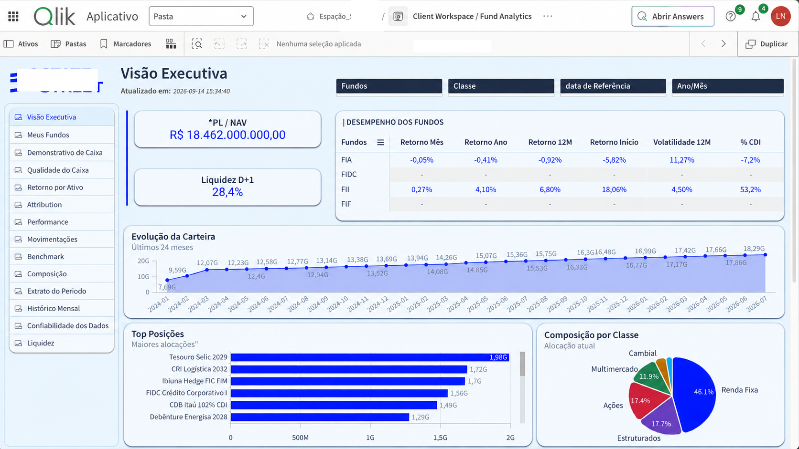
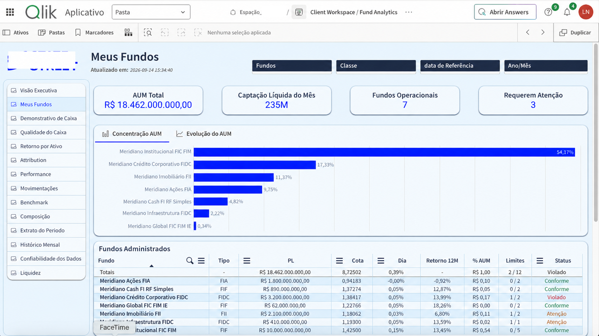
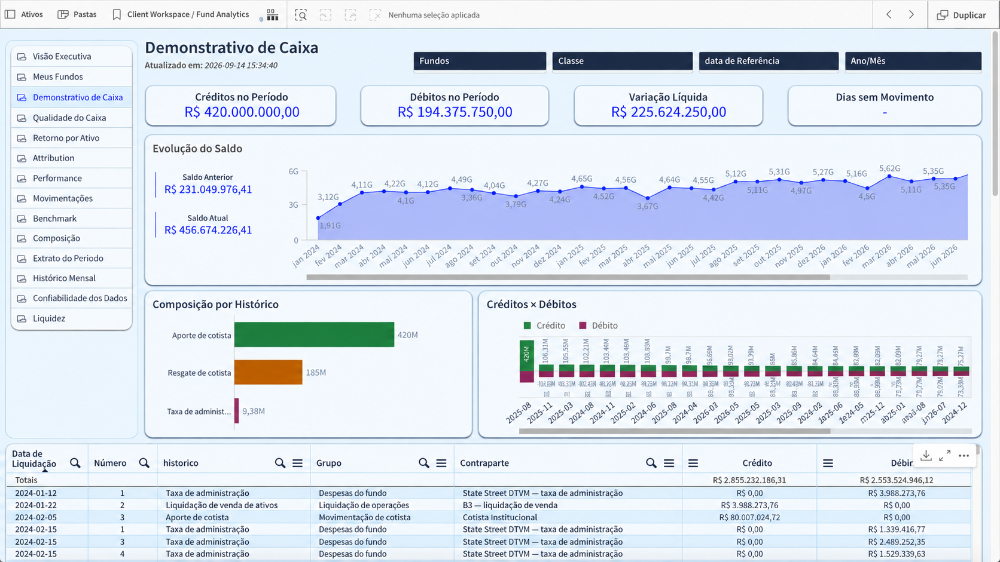

# Analytics de Fundos de Investimento


> Estudo de caso público para portfólio, com foco em analytics de fundos de investimento no Qlik. O repositório apresenta intencionalmente apenas algumas visões selecionadas enquanto outros módulos analíticos continuam em desenvolvimento.

## Visão geral

Este projeto apresenta uma aplicação analítica desenvolvida em Qlik para acompanhamento de fundos de investimento. A solução reúne visão executiva da carteira, monitoramento por fundo, análise de caixa, indicadores de desempenho, métricas de liquidez, visões de alocação e acompanhamento do status operacional.

A versão pública é intencionalmente objetiva. Ela destaca três áreas analíticas que representam melhor o estágio atual da solução:

1. **Visão Executiva**
2. **Meus Fundos**
3. **Extrato de Caixa**

## Objetivo de negócio

A solução foi desenvolvida para apoiar o acompanhamento de carteiras e a gestão de fundos por meio da consolidação dos principais indicadores em um único ambiente analítico.

A cobertura analítica atual inclui conceitos como:

- Acompanhamento de PL / NAV / AUM
- Evolução da carteira
- Retornos mensais e anuais
- Retorno em 12 meses
- Volatilidade
- Comparação com o CDI
- Liquidez
- Alocação de ativos
- Concentração por fundo
- Status e limites dos fundos
- Entradas e saídas de caixa
- Evolução do saldo de caixa

## Visões selecionadas dos dashboards

### 1. Visão Executiva

A Visão Executiva consolida os principais indicadores da carteira e apresenta uma visão geral do desempenho e da alocação dos fundos.

A visão publicada inclui:

- PL / NAV
- Liquidez D+1
- Retorno por classe de fundo
- Volatilidade
- Comparação com o CDI
- Evolução da carteira nos últimos 24 meses
- Maiores posições
- Composição da carteira por classe de ativo



### 2. Meus Fundos

A visão Meus Fundos permite acompanhar os fundos individualmente e analisar a concentração do patrimônio.

A implementação atual inclui:

- AUM total
- Captação líquida mensal
- Quantidade de fundos operacionais
- Fundos que exigem atenção
- Concentração de AUM por fundo
- Acompanhamento de status e limites por fundo



### 3. Extrato de Caixa

A visão Extrato de Caixa concentra-se nas movimentações de liquidez e no comportamento do caixa.

A implementação atual inclui:

- Créditos no período
- Débitos no período
- Variação líquida de caixa
- Saldo atual e anterior
- Evolução do saldo de caixa
- Composição do fluxo de caixa
- Comparação entre créditos e débitos



## Módulos em desenvolvimento

A aplicação também contempla outras áreas analíticas que ainda estão em desenvolvimento e que, intencionalmente, não são apresentadas integralmente neste repositório público.

Esses módulos incluem:

- Qualidade do Caixa
- Retorno por Ativo
- Atribuição de Resultado
- Desempenho
- Movimentações
- Análise de Benchmark
- Composição da Carteira
- Extrato por Período
- Histórico Mensal
- Confiabilidade dos Dados
- Liquidez

A presença desses módulos no planejamento reflete o objetivo mais amplo de evoluir a aplicação de um ambiente de acompanhamento de carteira para uma plataforma mais completa de analytics de fundos.

## Desenvolvimento Qlik

O projeto inclui atividades relacionadas a:

- Modelagem de dados no Qlik
- Medidas calculadas e KPIs
- Set Analysis
- Variáveis e expressões dinâmicas
- Análise de carteira por período
- Lógica de benchmark
- Filtros por fundo e classe
- Navegação analítica entre diferentes visões de negócio

## Conceitos analíticos

Um fluxo analítico simplificado pode ser representado da seguinte forma:

```text
Dados de Fundos / Carteira
        |
        v
Preparação de Dados no Qlik
        |
        v
Modelo Associativo de Dados
        |
        v
Regras de Negócio e Medidas
        |
        v
Analytics de Carteira / Fundos
        |
        +--> Acompanhamento Executivo
        +--> Monitoramento de Fundos
        +--> Análise de Caixa
        +--> Módulos de Desempenho e Benchmark
```

## Escopo do portfólio

Este repositório é um estudo de caso selecionado para portfólio e não representa a aplicação interna completa.

A versão pública exclui intencionalmente:

- Dados confidenciais de origem
- Credenciais de produção
- Detalhes internos de conexão
- Arquivos proprietários de dados
- Detalhes completos de implementações específicas de clientes

Somente capturas de tela selecionadas e documentação analítica generalizada são publicadas.

## Estrutura do repositório

```text
.
├── README.md
└── screenshots/
    ├── README.md
    ├── 02-executive-portfolio-composition.png
    ├── 03-my-funds-overview.png
    └── 05-cash-statement-overview.png
```

Consulte [Evidências em Capturas de Tela](screenshots/README.md).

---

**Projeto de portfólio de Luiz Felipe Nunes — Desenvolvedor de BI | Qlik | SQL | Análise de Dados**
