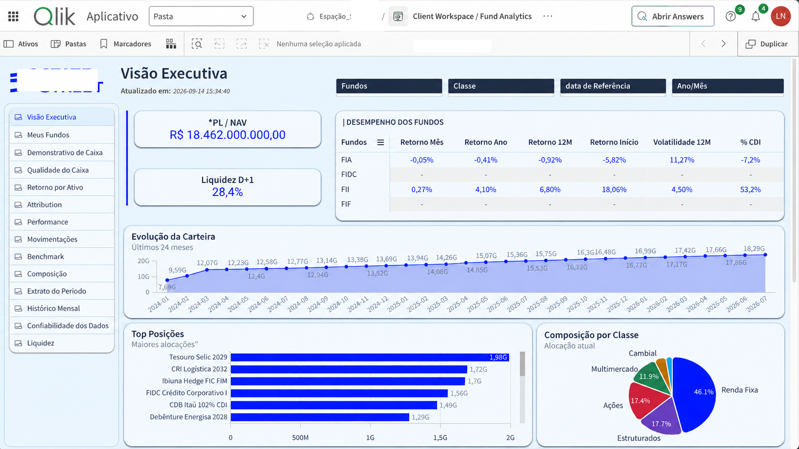
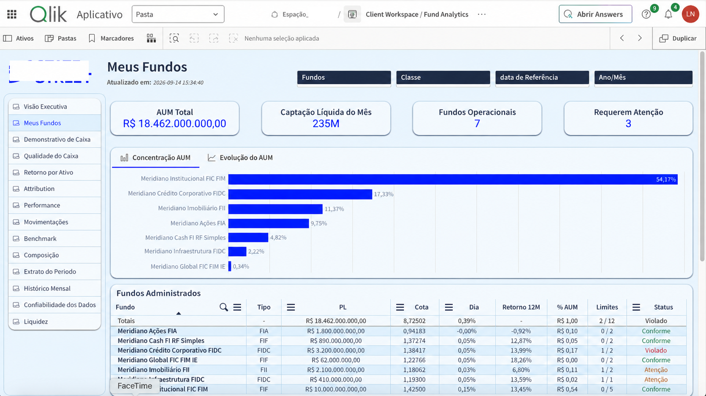
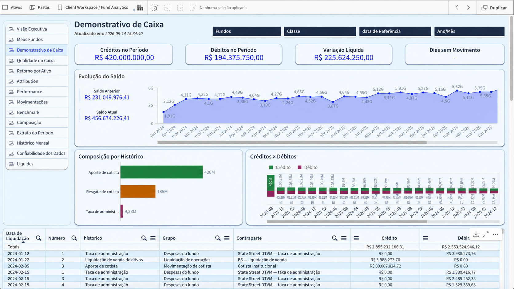

# Evidências em Capturas de Tela

Esta pasta contém as capturas de tela selecionadas para a versão pública do projeto Analytics de Fundos de Investimento.

Somente as visões abaixo são publicadas. Módulos adicionais continuam em desenvolvimento e, intencionalmente, não são apresentados em detalhes.

## Visão Executiva

Visão no nível da carteira, cobrindo PL / NAV / AUM, liquidez, desempenho dos fundos, evolução da carteira, principais posições e alocação por classe de ativo.

## Meus Fundos

Visão de acompanhamento dos fundos, cobrindo AUM, captação líquida mensal, fundos operacionais, indicadores de atenção, concentração e monitoramento no nível do fundo.

## Extrato de Caixa

Visão de análise de caixa, cobrindo créditos, débitos, variação líquida, evolução do saldo e composição do fluxo de caixa.

## Estratégia do portfólio público

O repositório apresenta intencionalmente apenas evidências analíticas selecionadas. Outras áreas da aplicação — incluindo qualidade do caixa, retorno por ativo, atribuição de resultado, desempenho, movimentações, benchmarks, composição, acompanhamento histórico, confiabilidade dos dados e liquidez — continuam evoluindo e não são publicadas integralmente aqui.
